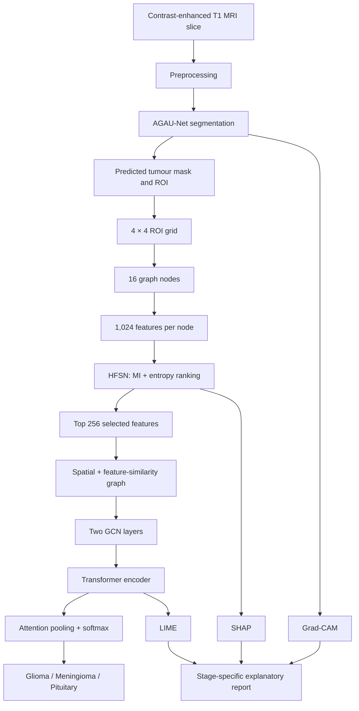

<div align="center">

# ICSS — Explainable Brain Tumour Segmentation and Classification

### Attention-guided adaptive U-Net · Hybrid feature selection · Transformer-augmented GCN

[](https://www.python.org/)
[](https://pytorch.org/)
[](https://colab.research.google.com/)
[](#scope-and-reproducibility)
[](#dataset)

**A research-stage, explainable pipeline for brain-tumour segmentation and three-class classification from contrast-enhanced T1-weighted MRI.**

</div>

> **Clinical-use notice.** ICSS is a research prototype, not a medical device or diagnostic system. It must not be used to make clinical decisions. Explanations are illustrative and have not been validated by clinicians.

---

## Contents

<details open>
<summary><strong>Navigate the repository</strong></summary>

- [Overview](#overview)
- [Research contributions and pipeline](#research-contributions-and-pipeline)
- [Reported results](#reported-results)
- [Repository structure](#repository-structure)
- [Dataset](#dataset)
- [Environment and installation](#environment-and-installation)
- [Run in Google Colab](#run-in-google-colab)
- [Run locally](#run-locally)
- [Configuration](#configuration)
- [Methodology](#methodology)
- [Evaluation protocol](#evaluation-protocol)
- [Explainability](#explainability)
- [Outputs](#outputs)
- [Reproducibility and limitations](#reproducibility-and-limitations)
- [Citation](#citation)
- [Acknowledgements](#acknowledgements)

</details>

## Overview

The Intelligent Clinical Support System (ICSS) combines tumour segmentation, region-level feature construction, feature selection, graph-based classification and post-hoc explainability in one MRI analysis pipeline.

| Stage | Component | Function |
|---|---|---|
| I | **AGAU-Net** | Residual U-Net with channel-wise attention gates and a learnable gain at each decoder level |
| II | **HFSN** | Deterministic hybrid ranking using normalized mutual information and feature entropy |
| III | **TA-GCN** | Graph convolution followed by transformer self-attention and attention pooling |
| XAI | **Grad-CAM, SHAP, LIME** | Explanations at segmentation, feature and graph-node levels |

The accompanying notebook contains the implementation, training/evaluation routines, optional baselines, explainability routines and model/result export code.

## Research contributions and pipeline



### Stage I — AGAU-Net

- 2-D residual encoder–decoder.
- Four encoder levels with 32, 64, 128 and 256 channels, followed by a 512-channel bottleneck in the article configuration.
- Channel-wise attention coefficients are applied to skip features.
- A learnable scalar gain is used at each decoder level.
- Segmentation objective: weighted combination of Dice loss and weighted binary cross-entropy.

### Stage II — HFSN

For each of the 16 ROI cells, the feature bank contains 1,024 descriptors:

- 128 radiomic descriptors: first-order statistics, histogram, GLCM, LBP and shape descriptors.
- 896 deep descriptors extracted from encoder/bottleneck feature maps using RoI-Align.

The ranking score is:

\[
S_j = \alpha\,MI_n(X_j;Y) + (1-\alpha)\,H_n(X_j)
\]

The article configuration uses \(\alpha=0.6\) and retains the top \(k=256\) features. Feature selection and standardization are fitted on the training partition and then applied unchanged to validation and test data.

### Stage III — TA-GCN

- 16 nodes represent the \(4\times4\) ROI cells.
- Spatial neighbourhood edges and cosine-similarity edges are combined.
- Two graph convolution layers produce node embeddings.
- A transformer encoder models dependencies between region nodes.
- Attention pooling aggregates node embeddings for three-class prediction.

### Explainability

| Method | Target | Interpretation level |
|---|---|---|
| Grad-CAM | AGAU-Net decoder activations | Segmentation localization |
| SHAP | TA-GCN prediction | Feature attribution |
| LIME | TA-GCN graph prediction | Region/node contribution |

The paper explicitly treats the explanations as illustrative. Quantitative faithfulness, stability and clinician agreement were not established.

## Reported results

The following values are transcribed from the accompanying research article, which reports a **single patient-level 70:15:15 split** on the public Figshare dataset.

### Segmentation — held-out tumour-containing slices

| Model | DSC | Pixel accuracy | IoU | HD95 (mm) |
|---|---:|---:|---:|---:|
| U-Net | 0.87 | 0.91 | 0.79 | 6.8 |
| Attention U-Net | 0.90 | 0.93 | 0.83 | 5.4 |
| V-Net (2-D) | 0.89 | 0.92 | 0.82 | 5.7 |
| **AGAU-Net** | **0.95** | **0.97** | **0.91** | **3.1** |

### Classification — held-out test partition

| Model | Accuracy (%) | Macro precision (%) | Macro sensitivity (%) | Macro F1 (%) | Macro AUC |
|---|---:|---:|---:|---:|---:|
| CNN-only | 84.6 | 83.9 | 83.1 | 83.5 | 0.89 |
| GCN-only | 87.6 | 86.8 | 86.2 | 86.5 | 0.91 |
| Transformer-only | 86.9 | 86.0 | 85.4 | 85.7 | 0.90 |
| **TA-GCN** | **91.0** | **90.4** | **89.7** | **90.0** | **0.94** |

**Interpretation boundary:** these are the article's reported values, not a guarantee that a fresh notebook execution will reproduce them. The notebook can produce new results depending on the runtime, dependencies, data preparation and random/nondeterministic GPU operations.

## Repository structure

```text
ICSS-Explainable-Brain-Tumor-Analysis/
├── README.md
├── requirements.txt
├── .gitignore
├── CITATION.cff
├── notebooks/
│   └── ICSS_Brain_Tumor_Pipeline.ipynb
└── docs/
    └── ICSS_Research_Article.pdf
```

## Dataset

Experiments reported in the article use the public **Figshare brain tumour dataset**:

- 3,064 two-dimensional contrast-enhanced T1-weighted MRI slices.
- 233 patients.
- Classes: glioma, meningioma and pituitary tumour.
- Radiologist-delineated tumour masks and patient identifiers.
- Dataset DOI: [10.6084/m9.figshare.1512427](https://doi.org/10.6084/m9.figshare.1512427).

The notebook downloads Figshare version 5 when `CFG['DOWNLOAD'] = True` and no local `.mat` files are found. The source data are not redistributed in this repository. Review the dataset's own terms and citation requirements before use.

<details>
<summary><strong>Optional notebook input modes — not part of the reported article experiments</strong></summary>

The notebook contains optional code paths for paired CT slices and a non-tumour class. The accompanying article's reported experiments are **MRI-only**, contain only the three tumour classes, and do not evaluate CT–MRI fusion or a normal class.

- `PAIRED_CT_DIR`: optional folder containing co-registered CT slices named to match Figshare identifiers (`.npy` in HU or `.png` already windowed).
- `NONTUMOR_DIR`: optional folder of normal MRI images.

These extensions require appropriate paired/labelled data and independent validation. Their presence in code must not be interpreted as evidence that they were evaluated in the paper.

</details>

## Environment and installation

The notebook was authored for Google Colab and uses PyTorch, torchvision, OpenCV, SimpleITK, scikit-image, scikit-learn, SciPy, h5py, SHAP and LIME. A CUDA-enabled GPU is recommended.

### Python dependencies

Create a virtual environment and install the listed packages:

```bash
python -m venv .venv
# Linux/macOS
source .venv/bin/activate
# Windows PowerShell
# .venv\Scripts\Activate.ps1

python -m pip install --upgrade pip
pip install -r requirements.txt
```

Install the PyTorch build appropriate for your CUDA/CPU environment using the [official PyTorch selector](https://pytorch.org/get-started/locally/). The notebook's first setup cell installs `SimpleITK`, `shap` and `lime`; the requirements file also lists them for local setup.

## Run in Google Colab

1. Upload `notebooks/ICSS_Brain_Tumor_Pipeline.ipynb` to Google Colab.
2. Select **Runtime → Change runtime type → T4 GPU** (or another compatible GPU).
3. Run the notebook cells in order.
4. The notebook downloads and preprocesses Figshare data by default.
5. Inspect the configuration cell before starting a full training run.
6. Run the main pipeline and inspect the exported metrics/figures.

[](https://colab.research.google.com/)

> The notebook's `QUICK` option is a smoke-test configuration with reduced epochs/samples; it is not the article's full training configuration. Baseline runs are enabled by default. Ablation, grid search and cross-validation are disabled by default.

## Run locally

The notebook uses Colab-style paths by default (`/content/...`). For local execution, edit `CFG['DATA_DIR']` and `CFG['WORK_DIR']` in the configuration cell to valid local directories, then run the notebook with Jupyter.

```bash
jupyter lab notebooks/ICSS_Brain_Tumor_Pipeline.ipynb
```

The notebook expects the Figshare MATLAB v7.3 `.mat` files to be available beneath `DATA_DIR`, or `DOWNLOAD=True` to retrieve them. Confirm that your environment can access the Figshare downloader and has enough disk space and GPU memory before a full run.

## Configuration

The main configuration is centralized in the notebook's `CFG` dictionary.

| Parameter | Article/configuration value | Purpose |
|---|---:|---|
| `IMG_SIZE` | 256 | Input image size |
| `SPLIT` | (0.70, 0.15, 0.15) | Patient-level train/validation/test split |
| `SEED` | 42 | Random seed |
| `BATCH` | 16 | Training batch size |
| `LR` | 1e-4 | Adam learning rate |
| `WEIGHT_DECAY` | 1e-4 | Weight decay |
| `EPOCHS_SEG`, `EPOCHS_CLS` | 150 | Maximum epochs |
| `PATIENCE` | 15 | Early-stopping patience |
| `GRID` | 4 | ROI grid dimension; 16 nodes |
| `TOPK` | 256 | Selected features |
| `ALPHA` | 0.6 | MI/entropy combination coefficient |
| `ENTROPY_BINS` | 32 | Feature discretization bins |
| `TAU` | 0.8 | Cosine-similarity edge threshold |
| `GCN_HIDDEN` | 128 | Graph hidden dimension |
| `N_HEADS` | 4 | Transformer attention heads |
| `DROPOUT` | 0.3 | Classifier dropout |

To perform a short smoke test, set `QUICK=True`. The notebook then reduces epoch counts and explanation samples. Do not use quick-mode output as a substitute for the reported experiment.

## Methodology

### MRI preprocessing

The article describes the following sequence:

1. Resize image and mask to \(256\times256\) (nearest-neighbour interpolation for masks).
2. N4 bias-field correction.
3. Heuristic brain-mask generation using Otsu thresholding, connected components and morphology.
4. Percentile intensity scaling.
5. Non-local-means denoising.
6. Z-score normalization within the brain mask, followed by clipping/scaling to \([0,1]\).

The article notes that the heuristic brain mask was not independently validated and that no registration was performed.

### Patient-level partitioning

All slices from a patient are assigned to one partition. The article reports a 70:15:15 split with seed 42. It reports a single split rather than patient-grouped five-fold cross-validation.

### Training and evaluation

- Adam optimizer; learning rate \(10^{-4}\); weight decay \(10^{-4}\).
- Batch size 16; maximum 150 epochs; early stopping patience 15.
- Segmentation loss: \(0.7\,L_{\mathrm{Dice}}+0.3\,L_{\mathrm{wBCE}}\).
- Classification loss: class-weighted cross-entropy.
- Validation-selected weights are restored for evaluation.

## Evaluation protocol

**Segmentation:** per-slice DSC, IoU, pixel accuracy and HD95 on tumour-containing test slices. Empty ground-truth masks after resizing are excluded. Empty predictions receive DSC and IoU of zero and are excluded from HD95.

**Classification:** per-slice three-class evaluation using accuracy, per-class and macro precision, sensitivity, specificity and F1-score, plus one-vs-rest macro AUC. Metrics are computed from the same saved test predictions.

The article reports point estimates from one run and one split, without variance estimates or significance tests. Pixel accuracy can be dominated by background pixels.

## Explainability

The notebook provides:
- Grad-CAM using the final decoder block and a target based on logits within the predicted mask.
- SHAP feature attributions using a training-graph background set.
- LIME node-level explanations using sampled on/off patterns over graph nodes and a weighted ridge surrogate.
- A notebook dashboard for selecting test cases and generating a combined report.

The article states that explanation faithfulness, stability and clinician agreement were not quantitatively evaluated. Treat generated maps and attributions as exploratory visualizations.

## Outputs

The notebook's export section writes artefacts under `CFG['WORK_DIR']`, including:

- `agau_net.pt` — AGAU-Net model weights.
- `ta_gcn.pt` — TA-GCN model weights.
- `hfsn.npz` — selected feature indices, standardization statistics and feature scores.
- `results.json` — configuration and aggregate results.
- `segmentation_per_slice.csv` — per-slice segmentation metrics.
- `figures/` — generated plots and explanatory visualizations (depending on executed cells).

Generated model weights and metrics are not committed to this repository. Re-run the notebook to produce them.

## Reproducibility and limitations

Please account for the following when interpreting or reproducing results:

1. **Single dataset and split:** the article uses one public dataset and one patient-level split; external multicentre validation is not reported.
2. **Single-run estimates:** no repeated-run variance estimates or significance tests are reported.
3. **2-D data:** slices are two-dimensional with 6 mm slice thickness and a 1 mm gap; slice-level metrics may weight patients unequally.
4. **No normal class in the reported dataset:** the classifier is a three-class tumour classifier, not a screening model.
5. **MRI-only reported experiments:** no CT data were analysed and no CT–MRI fusion result is claimed.
6. **Heuristic brain mask:** its accuracy was not validated.
7. **Feature-selection ablation:** the article does not verify the incremental contribution of entropy beyond mutual information.
8. **Component ablations:** the individual contributions of attention gates, HFSN and graph construction were not established in the article.
9. **XAI validation:** explanation faithfulness, stability and clinical utility were not assessed.
10. **GPU nondeterminism:** a seed is set, but cuDNN is not deterministic; repeated runs can differ.

The notebook contains optional switches for ablation, grid search and cross-validation. These are additional experiments and should be run and reported separately; they are not results to attribute to the article unless actually executed and documented.

## Citation

If you use the method or implementation, cite the accompanying article and the original dataset.

**Article metadata as supplied in the manuscript:**

Sathya A, Jeevika Tharini V, and Aruna A. *Explainable brain tumour segmentation and classification on contrast-enhanced MRI using an attention-guided adaptive U-Net, hybrid feature selection and a transformer-augmented graph convolutional network.* Research article manuscript supplied with this repository.

**Dataset:**

Cheng J. Brain tumor dataset. Figshare (2017). [https://doi.org/10.6084/m9.figshare.1512427](https://doi.org/10.6084/m9.figshare.1512427).

A BibTeX entry for the manuscript can be added when the final journal volume, issue, pages and DOI are available. Do not invent publication metadata.

## Acknowledgements

The authors acknowledge the creators of the publicly available Figshare brain tumour dataset for providing annotated imaging data for research use.

---

<div align="center">

**ICSS · Research-stage MRI analysis pipeline**

If you build on this work, please cite the article and dataset and report any modifications to the experimental protocol.

</div>
